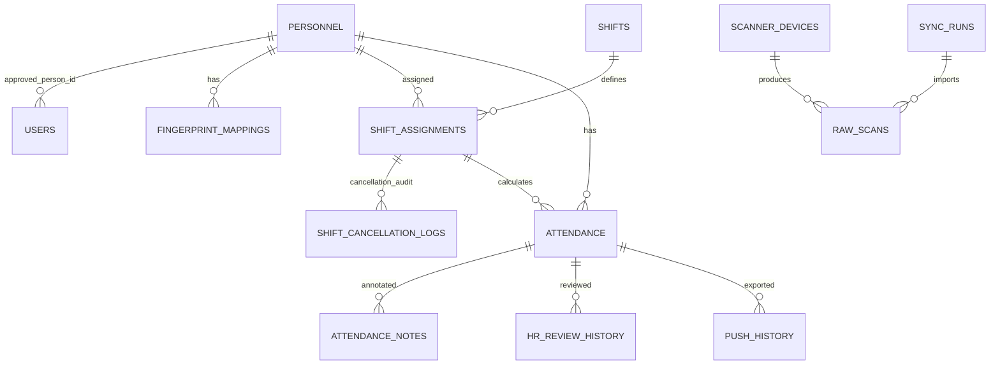

# Sam_Att V2 Standalone — Database Schema & Data Integrity Specification

## 1. ภาพรวมฐานข้อมูล
- **Database Name มาตรฐาน:** `samchuk_attendance_v2`
- **Engine & Charset:** MySQL 8.0+ (`InnoDB`, `utf8mb4`, `utf8mb4_unicode_ci`)
- **Timezone มาตรฐาน:** `Asia/Bangkok` (`UTC+07:00`)
- **จำนวนตาราง:** 19 ตารางตาม Baseline เดิม + 1 ตาราง `deployment_history` สำหรับระบบ Standalone Update/Backup/Rollback + 1 ตาราง `schema_migrations` สำหรับควบคุมเวอร์ชัน Migration

## 2. Entity-Relationship Diagram (ERD)

## 3. รายละเอียดตารางทั้งหมด (20 ตารางหลัก)

1. **`users`**: เก็บบัญชีผู้ใช้งาน, `password_hash` (scrypt + salt), `role` (`ADMIN`, `RESPONSIBLE_STAFF`, `GENERAL_USER`), และ `approved_person_id` ที่ผูกกับ `personnel.person_id`
2. **`personnel`**: Snapshot บุคลากรจาก HOSOffice `hr_person` (Read-only Source of Truth)
3. **`fingerprint_mappings`**: ประวัติการจับคู่ `fingle_id` กับ `person_id` พร้อม `effective_from`, `effective_to` และ `conflict_state`
4. **`personnel_type_rules`**: กฎเวลาสายและหน้าต่างการสแกนแยกตามประเภทบุคลากร
5. **`shifts`**: นิยามกะ (เช้า, บ่าย, ดึก, ราชการ, พิเศษ, กะข้ามวัน)
6. **`shift_assignments`**: ตารางมอบหมายเวรรายบุคคล พร้อม Snapshot กฎของกะ ณ เวลาที่มอบหมาย
7. **`shift_cancellation_logs`**: ประวัติการยกเลิกเวรแบบ Soft Cancel พร้อมผู้ยกเลิกและเหตุผล
8. **`scanner_devices`**: ทะเบียนเครื่องสแกนลายนิ้วมือ/ใบหน้า (`machine_no`, IP, Port, สถานะ)
9. **`sync_schedules`**: ตารางกำหนดเวลาซิงก์อัตโนมัติ (เช่น `00:00`, `08:00`)
10. **`sync_runs`**: ประวัติการทำงานของแต่ละรอบการซิงก์เครื่องสแกน
11. **`raw_scans`**: ข้อมูลสแกนต้นฉบับแบบ Immutable 6 ฟิลด์ตามสัญญา EXE (`machineNo`, `enrollNumber`, `scanDateTime`, `verifyMode`, `inOutMode`, `workCode`) พร้อม `event_dedup_key` (SHA-256 Canonical Key)
12. **`attendance`**: ผลการคำนวณเวลาปฏิบัติงาน (Derived Data) ที่สามารถ Reprocess ซ้ำได้โดยไม่กระทบ `raw_scans`
13. **`attendance_notes`**: หมายเหตุและคำชี้แจง `NO_SCAN` / `MISSING_CHECKOUT` แยกตารางจาก `raw_scans` และไม่ถูกลบเมื่อ Reprocess
14. **`hr_review_history`**: ประวัติการตรวจสอบและอนุมัติผลโดยเจ้าหน้าที่ HR
15. **`push_history`**: ประวัติการทำ Preview (`DRY_RUN`) และ Live Push ไปยัง HOSOffice พร้อม `idempotency_key`
16. **`hosoffice_sync_logs`**: ประวัติการดึงข้อมูลบุคลากรจากฐานข้อมูล HOSOffice
17. **`audit_logs`**: บันทึกเหตุการณ์สำคัญด้านความปลอดภัยและการปฏิบัติงานทุกเมนู
18. **`revoked_sessions`**: รายการ JWT/Session ที่ถูกยกเลิกก่อนหมดอายุ
19. **`auth_rate_limits`**: ตารางควบคุมการลองรหัสผ่านผิดซ้ำเพื่อป้องกัน Brute-force
20. **`deployment_history`**: ตารางบันทึกประวัติการติดตั้ง, สำรองข้อมูล, อัปเดต และ Rollback ของระบบ Standalone Windows Service
