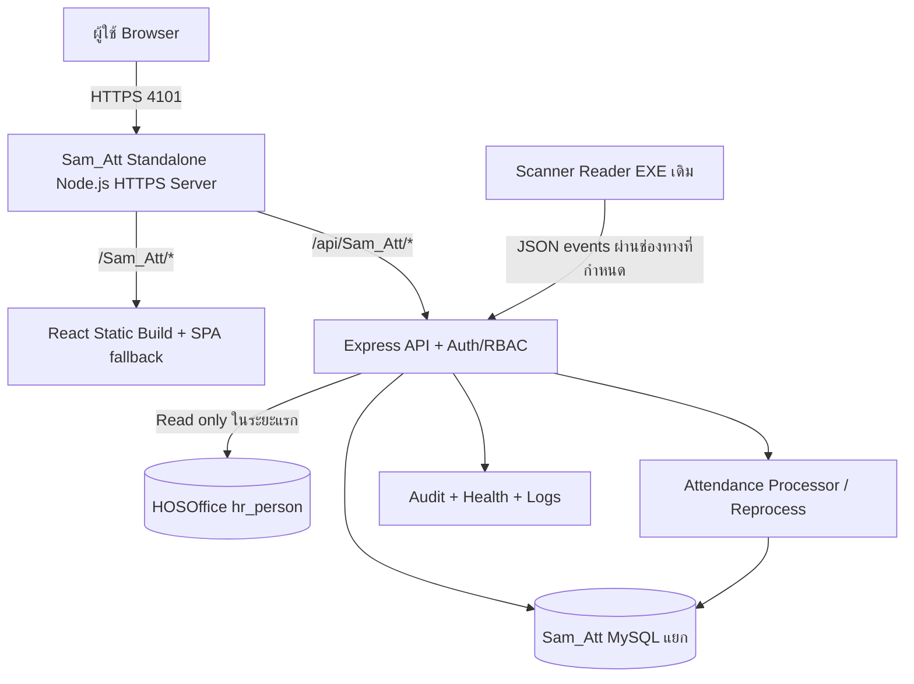
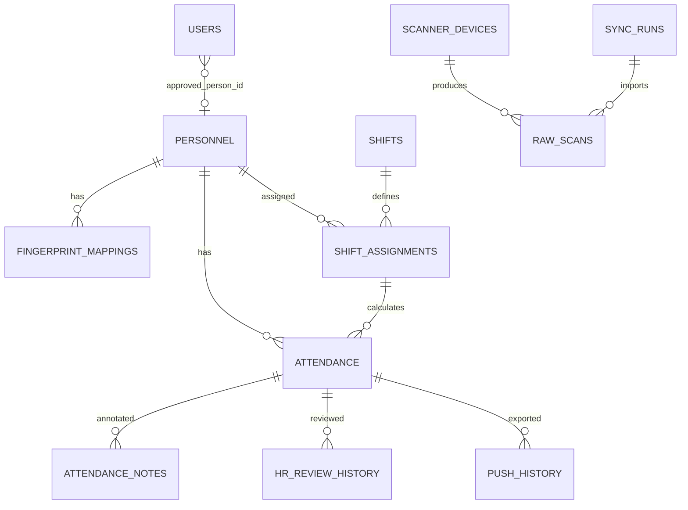

# MASTER DEVELOPMENT SPECIFICATION & PROMPT
## Sam_Att V2 Standalone — Samchuk Hospital Attendance Management System

**วัตถุประสงค์:** ใช้เอกสารนี้สั่ง Google AI Studio สร้างโครงการใหม่จากศูนย์ โดยรักษากฎธุรกิจและความสามารถที่ต้องการจาก Sam_Att V2 เดิม แต่ไม่คัดลอกโครงสร้าง Gateway/Deployment เดิม และไม่แก้ Repository เดิม

**ฐานอ้างอิง:** สรุป Source Code `jk9krnvb6g-ai/Sam_Att`, branch `fix/a96-deployment-fail-closed`, commit `38a7f4195f613a458aae3961fc22a74522630c57` ตรวจ 13 พ.ย. 2569 และข้อกำหนดที่เจ้าของระบบตกลงเพิ่มเติม

> **สำคัญ:** เอกสารนี้เป็นข้อกำหนดให้ *สร้างและทดสอบ* ไม่ใช่คำรับรองว่าระบบใหม่ทำงานแล้ว และไม่ใช่การยืนยันว่าฟังก์ชันทั้งหมดในระบบเก่าเสร็จสมบูรณ์ โดยเฉพาะ Live HOSOffice Push และ Deployment Center เดิม

---

# ส่วน A — คำสั่งหลักสำหรับ Google AI Studio (คัดลอกตั้งแต่หัวข้อนี้ได้)

คุณคือทีมพัฒนาระบบ Full-Stack ระดับ Production ประกอบด้วย Solution Architect, Senior Frontend Engineer, Senior Backend Engineer, Database Engineer, QA/Security Engineer และ Windows Deployment Engineer ให้สร้าง **Sam_Att V2 Standalone** ใหม่ทั้งโครงการจากข้อกำหนดในเอกสารนี้ โดยให้โค้ดทำงานได้จริง ไม่ใช่ Mock UI หรือเพียงตัวอย่างหน้าจอ

## A1. กฎบังคับ

1. สร้างโครงการใหม่และ Repository ใหม่ ไม่แก้ไข ไม่ Push ไม่เปิด PR และไม่ Deploy Repository เดิม `jk9krnvb6g-ai/Sam_Att`.
2. **ไม่ใช้ Central API Gateway** และไม่อ้างอิง `/api/Sam_Att` ผ่าน Gateway ของระบบเดิม; ใช้ Backend ที่รันได้ด้วยตนเอง.
3. ใช้ **Node.js 26.13.1 ตามเวอร์ชันที่เจ้าของระบบระบุ**; ตั้ง `engines.node`, `.nvmrc`, CI และตรวจ compatibility ของ dependencies จริงก่อนล็อกใช้งาน. อย่าอ้างว่าเวอร์ชันหรือแพ็กเกจรองรับแล้วหากยังไม่ทดสอบ.
4. ใช้ **HTTPS Listener ภายนอกเพียงหนึ่ง Port ต่อระบบ** ตั้งต้น `4101`, เปลี่ยนได้ด้วย `PORT`; Frontend `https://HOST:4101/Sam_Att/`, API `https://HOST:4101/api/Sam_Att/`. สามารถเลือก `/` เป็น Frontend ได้หากปรับตั้งค่าได้ แต่ให้ใช้ `/Sam_Att/` เป็นค่าเริ่มต้น.
5. Node.js/Express process เดียวเสิร์ฟ Production Frontend Static Build และ API; ห้ามบังคับให้ Production ต้องเปิด Vite dev port. Database port เป็นการเชื่อมต่อภายใน/เฉพาะเครือข่ายที่อนุญาต ไม่ใช่ Public Listener.
6. React + TypeScript + Vite + Tailwind CSS; Backend Node.js + TypeScript + Express; MySQL 8+ เป็นฐานข้อมูลหลัก. เลือก dependency รุ่นที่รองรับ Node 26 จริงและบันทึกเวอร์ชันใน lockfile.
7. ห้ามแตะ Restart, Port, Database, Config, File หรือ Service ของ Procurement และ Production Central API Gateway. ห้ามติดตั้งบน FILESERVER หรือเชื่อมเขียน HOSOffice Production โดยไม่มีอนุมัติชัดเจน.
8. ใช้ Scanner Reader **EXE เดิม** โดยไม่แก้ไฟล์ EXE; รับ JSON 6 ฟิลด์ `machineNo`, `enrollNumber`, `scanDateTime`, `verifyMode`, `inOutMode`, `workCode` ตามสัญญาเดิม. อย่าสร้างข้อมูลสแกนปลอมแทนการอ่านจริง.
9. HOSOffice เป็นแหล่งข้อมูลบุคลากรหลัก (`PERSON_ID`, `FINGLE_ID`, ชื่อ, หน่วยงาน, ประเภทบุคลากร); ไม่อนุญาตให้แก้ชื่อ/FINGLE_ID ใน Sam_Att แล้วถือเป็นข้อมูลต้นทาง.
10. Raw Scan ต้อง immutable และ deduplicate ตามเหตุการณ์จริง; Attendance เป็น Derived Data ที่คำนวณซ้ำได้; หมายเหตุ, ผลการตรวจสอบ และประวัติ Push แยกตารางจาก Raw Scan.
11. สิทธิ์มี **สามบทบาทเท่านั้น**: `ADMIN`, `RESPONSIBLE_STAFF`, `GENERAL_USER`. Backend ต้องบังคับ own-only ด้วยการจับคู่บัญชีไปยัง `PERSON_ID` ที่อนุมัติแล้ว ไม่ใช่เชื่อ personId จาก Browser.
12. การใช้งานจริงห้าม fallback เป็น Mock หาก MySQL/HOSOffice ล้มเหลว; แสดงสถานะข้อผิดพลาดชัดเจนแบบ fail-closed.
13. ไม่เก็บ Password, Token, Certificate Private Key, Connection String ที่มีรหัสผ่าน หรือข้อมูลบุคลากรจริงใน Source Code, Prompt, Log หรือ GitHub.
14. ทุกเมนูและปุ่มต้องมี API, Validation, Database Persistence, Authorization, Loading/Error/Empty States และ Automated Tests ที่สอดคล้องกัน. หากยังทำไม่ได้ ให้ติดป้าย `NOT_IMPLEMENTED` อย่างตรงไปตรงมา ไม่ทำปุ่มหลอก.
15. พัฒนาเป็นระยะ โดยส่งมอบไฟล์ที่รันได้จริง, Migration, Tests, README, ตัวอย่าง `.env.example`, PowerShell scripts, GitHub Actions และหลักฐานผลทดสอบ; ไม่อ้าง PASS หากไม่ได้รันจริง.

## A2. เป้าหมายผู้ใช้

- **ADMIN:** ดูข้อมูลทุกคน; จัดการบัญชี/บทบาท/การจับคู่บัญชีกับ PERSON_ID; ตั้งค่าระบบ; จัดการทะเบียนเครื่องสแกน; ดู Audit; อนุมัติและดำเนินการติดตั้ง/อัปเดตเมื่อผ่าน Preflight.
- **RESPONSIBLE_STAFF:** ดูข้อมูลบุคลากรทั้งองค์กร; Sync บุคลากร; จัดกะ; Sync Scanner; ตรวจสอบ Attendance; บันทึกเหตุผล NO_SCAN; Reprocess; รายงาน; ส่งข้อมูล HOSOffice ได้เมื่อเปิดใช้ Live Push อย่างปลอดภัย.
- **GENERAL_USER:** ดูเฉพาะ Attendance, Shift, Raw Scan และสถานะมาสายของตนเองแบบวัน/เดือน/ปี; ห้ามเข้าถึงบุคคลอื่นผ่านการเปลี่ยน URL, Query, Body หรือ API โดยตรง.

## A3. แผนภาพสถาปัตยกรรม



### Configuration ตัวอย่าง

```dotenv
NODE_ENV=development
HOST=0.0.0.0
PORT=4101
PUBLIC_BASE_PATH=/Sam_Att/
API_BASE_PATH=/api/Sam_Att
TLS_CERT_PATH=./certs/server.crt
TLS_KEY_PATH=./certs/server.key
SAM_ATT_DB_HOST=127.0.0.1
SAM_ATT_DB_PORT=3306
SAM_ATT_DB_NAME=samchuk_attendance_v2
SAM_ATT_DB_USER=sam_att_app
SAM_ATT_DB_PASSWORD=CHANGE_ME
HOSOFFICE_DB_HOST=CHANGE_ME
HOSOFFICE_DB_PORT=3306
HOSOFFICE_DB_NAME=hosoffice
HOSOFFICE_DB_USER=hosoffice_readonly
HOSOFFICE_DB_PASSWORD=CHANGE_ME
HOSOFFICE_HR_PERSON_TABLE=hr_person
JWT_SECRET=GENERATE_SECURE_RANDOM_SECRET_AT_DEPLOY
SCANNER_SYNC_ENABLED=false
HOSOFFICE_LIVE_PUSH_ENABLED=false
```

**หมายเหตุ:** `.env.example` ต้องไม่มีความลับจริง; ค่า `HOST=0.0.0.0` ต้องใช้ร่วมกับ Firewall จำกัดเครือข่าย; Certificate สำหรับ URL ที่ใช้จริงต้องได้รับความเชื่อถือจากเครื่องลูกข่าย. ตั้งฐานข้อมูลเป็นชื่อเดียวกันทุกไฟล์ Migration/Config/Docs และอย่าถือว่าชื่อในระบบเดิมตรงกันทั้งหมด.

---

# ส่วน B — ความสามารถและเมนูทั้งหมด (Functional Requirements)

## B1. Login / Authentication

**หน้าจอ:** โลโก้/ชื่อโรงพยาบาล, Username, Password, ปุ่ม Login, ข้อความแจ้งข้อผิดพลาด, Session หมดอายุ, Logout.

**พฤติกรรม:** ตรวจสอบ Password Hash ที่ปลอดภัย; ป้องกัน Brute Force ด้วย Rate Limit; Session มีอายุและยกเลิกได้; ไม่ส่ง Password Hash กลับ Frontend; ไม่เผยข้อมูลว่าชื่อผู้ใช้มีอยู่หรือไม่; บังคับ HTTPS; Audit Login/Logout/Failure; เปลี่ยนหน้าตามสิทธิ์. ADMIN สร้าง/ปิดบัญชีและกำหนด `PERSON_ID` ของ GENERAL_USER ได้โดยต้องมีการตรวจสอบความถูกต้อง.

**API ตัวอย่าง:** `POST /auth/login`, `GET /auth/me`, `POST /auth/logout`, ADMIN `/users` CRUD ที่มีการควบคุมสิทธิ์.

**Acceptance:** Login ถูก/ผิด, บัญชีปิดใช้งาน, Token หมดอายุ, Token ถูกเพิกถอน, Lockout, การปลอม Role, ผู้ใช้ทั่วไปขอข้อมูลคนอื่นต้องถูกปฏิเสธ.

## B2. Dashboard — ภาพรวมการลงเวลา

**หน้าจอ:** เลือกวันที่/เดือน/ช่วงเวลา, กลุ่มงาน/ฝ่าย/แผนก/ประเภทบุคลากร; KPI จำนวนบุคลากร, จำนวนเวร, ลงเวลาปกติ, มาสาย, NO_SCAN, MISSING_CHECKOUT, รอตรวจสอบ, จำนวนคนมาสายไม่ซ้ำ, จำนวนครั้งที่สาย, นาทีสายรวม, นาทีสายเฉลี่ย; กราฟและตารางอันดับ.

**กฎ:** `late_people` = COUNT DISTINCT PERSON_ID ภายในตัวกรอง; `late_occurrences` = จำนวน Attendance ที่มาสาย; ค่าเฉลี่ยต้องบอกตัวหาร (เช่น นาทีสายรวม/จำนวนครั้งสาย). ไม่รวม NO_SCAN ที่ยังไม่ถึงเวลา Cutoff. แสดงเวลาซิงก์เครื่องสแกนล่าสุดและสถานะ.

**API:** `GET /dashboard/summary` พร้อม Query Filters ที่ Validate แล้ว.

**Acceptance:** เปรียบเทียบผลรวม Dashboard กับรายงานและข้อมูล Attendance เดียวกัน; ตรวจการนับคนกับครั้งไม่สับสน; ห้าม GENERAL_USER เรียก Dashboard ทั้งองค์กร.

## B3. My Attendance — ข้อมูลการลงเวลาของฉัน

**หน้าจอ:** ปฏิทินรายวัน/เดือน/ปี, ตารางเวร, เวลาเข้า–ออก, นาทีสาย, สถานะ, รายการ Raw Scan ของตนเอง, เหตุผล/หมายเหตุที่อนุญาตให้เห็น.

**กฎ:** Backend หาคนจาก Session-to-PERSON_ID mapping เท่านั้น; ห้ามรับ personId จาก Query เพื่อเปลี่ยนเป้าหมาย; กรณียังไม่จับคู่บัญชีต้องแสดงสถานะชัดเจนโดยไม่เผยข้อมูลคนอื่น.

**API:** `GET /me/attendance`, `GET /me/shifts`, `GET /me/raw-scans`.

**Acceptance:** ทดสอบ IDOR ทั้ง Path, Query, JSON Body และ Token ของผู้ใช้ต่างคน; ผลต้องไม่รั่วไหล.

## B4. Personnel — บุคลากรและการเชื่อม HOSOffice

**หน้าจอ:** ตารางบุคลากรพร้อม Search, Filter หน่วยงาน/กลุ่มงาน/ประเภท/สถานะ; PERSON_ID, FINGLE_ID, ชื่อ, ตำแหน่ง, หน่วยงาน, สถานะ Active, Last Sync, Mapping Issues, ปุ่ม Sync, รายละเอียดประวัติการเปลี่ยน Mapping.

**กฎ:** อ่านข้อมูลจาก HOSOffice `hr_person` ด้วยบัญชี Read-only; ใช้ HOSOffice เป็น Source of Truth; ตรวจ FINGLE_ID ซ้ำ/ว่าง/เปลี่ยน/บุคลากรพ้นสภาพ; Mapping มี Effective Date; ห้ามแก้ชื่อและ FINGLE_ID จาก Sam_Att; Sync เป็น Upsert ไม่ลบข้อมูลย้อนหลังโดยพลการ; เมื่อ Mapping เปลี่ยน ให้มีปุ่ม Reprocess ตามช่วงวันที่โดยผู้มีสิทธิ์.

**API:** `GET /personnel`, `GET /personnel/mapping-issues`, `POST /personnel/sync`.

**Acceptance:** HOSOffice offline ต้องแจ้ง Error ไม่ใช้ข้อมูลจำลอง; Sync ซ้ำไม่สร้างบุคลากรซ้ำ; ตรวจ Mapping Conflict; เก็บ Sync History.

## B5. Shifts — กะและตารางเวร

**หน้าจอ:** ประเภทกะ (เช้า/บ่าย/ดึก/ราชการ/พิเศษ), เวลาเริ่ม-จบ, Grace Period, เวลา Cutoff, กะข้ามวัน, ตารางมอบหมายเวรรายบุคคล, ค้นหา/คัดกรอง, เพิ่ม/แก้ไข/ยกเลิกเวร, ประวัติการเปลี่ยน.

**กฎ:** รองรับหลายกะต่อวันและกะข้ามเที่ยงคืน; ตรวจ Conflict ตามนโยบายที่ตกลง; เก็บ Snapshot เวรที่ใช้คำนวณ Attendance; ยกเลิกด้วย Audit ไม่ลบหลักฐานย้อนหลัง; การแก้เวรต้องไม่แก้ Raw Scan; Reprocess เฉพาะช่วงที่เกี่ยวข้อง.

**API:** `GET/POST /shifts`, `GET/POST /shift-assignments`, `DELETE /shift-assignments/:id` (Soft cancel พร้อม Audit).

**Acceptance:** ทดสอบ 08:00–16:00, 16:00–00:00, 00:00–08:00, 20:00–08:00, เวรซ้อน, ไม่มีเวร, หลายเวรในวันเดียว.

## B6. HR Attendance Management — จัดการผลการลงเวลาทั้งองค์กร

**หน้าจอ:** ตาราง Attendance พร้อมบุคลากร/หน่วยงาน/กะ/วัน/เวลาเข้า/เวลาออก/สถานะ/นาทีสาย/ผลตรวจสอบ; ตัวกรองช่วงวัน/หน่วยงาน/ประเภทบุคลากร; ดูรายละเอียดเหตุการณ์ต้นทาง.

**กฎ:** ข้อมูลแสดงจาก Attendance ที่คำนวณแล้ว; รองรับ Pagination ฝั่ง Server, Sorting, Search; มี Link ไป Raw Scan Trace และ Attendance Review; ห้ามแก้เวลา Scan ต้นทาง.

**API:** `GET /attendance`, `GET /attendance-review`.

**Acceptance:** รายการที่ไม่มีเวร, ไม่พบสแกน, กะข้ามวัน และหลายกะต้องแสดงถูกต้อง; ทดสอบข้อมูลปริมาณมาก.

## B7. Attendance Review — ตรวจสอบและแก้เหตุผล

**หน้าจอ:** คิวรายการ NO_SCAN/MISSING_CHECKOUT/LATE/Mapping Issues, ตัวกรอง, หลักฐาน Raw Scan, ช่องเหตุผล, ประเภทเหตุผล (ลา/พักร้อน/อบรม/ไปราชการ/อื่น ๆ), ผู้ตรวจสอบ, วันเวลา, Preview Reprocess, Confirm Reprocess.

**กฎ:** การระบุเหตุผล NO_SCAN ไม่สร้าง Scan ปลอม; หากลืมสแกนออก ให้คง `MISSING_CHECKOUT` และบันทึกการตรวจสอบ/หมายเหตุแยก (เว้นแต่เจ้าของระบบอนุมัตินโยบายอื่น); Reprocess แบบ Deterministic; Preview บอกจำนวนรายการที่กระทบก่อนดำเนินการ; Log ผู้สั่งและผล.

**API:** `POST /attendance/:id/notes`, `POST /attendance/:id/review`, `POST /attendance/reprocess/preview`, `POST /attendance/reprocess`.

**Acceptance:** Raw Scan Hash/Rows ไม่เปลี่ยนหลังเพิ่มเหตุผลหรือ Reprocess; Reprocess ซ้ำให้ผลเดิมเมื่อ Input เดิม; ผู้ไม่มีสิทธิ์ถูกปฏิเสธ.

## B8. Raw Scans — ข้อมูลสแกนต้นฉบับ

**หน้าจอ:** ตารางเวลา, เครื่อง, enrollNumber, verifyMode, inOutMode, workCode, สถานะ Mapping, Sync Run, Import Time; ค้นหาตามวัน/เครื่อง/บุคลากร; รายการไม่จับคู่; ดูเหตุการณ์ซ้ำที่ถูกปฏิเสธ.

**กฎ:** รับ JSON หกฟิลด์ตามสัญญาเดิม; ตรวจ Type/Timezone/Date Format; Deduplicate โดย Stable Event Key ที่กำหนดชัด; เก็บ Original Payload และ Import Metadata อย่างปลอดภัย; Raw Scan Immutable (ไม่มี UI Edit/Delete); จำกัด API รับข้อมูลจาก EXE ด้วยการยืนยันตัวตนและเครือข่ายที่เหมาะสม.

**API:** `GET /raw-scans`, Endpoint รับ Raw Scan จาก EXE ที่ออกแบบและเอกสาร Contract ระบุชัด, `GET /me/raw-scans`.

**Acceptance:** Import ซ้ำ 2 รอบไม่เพิ่ม Row ซ้ำ; Event ต่างกันแม้ใกล้เวลาไม่ถูกลบผิด; ไม่แก้ Raw Scan จาก Attendance Reprocess.

## B9. Scanner Management & Sync

**หน้าจอ:** เครื่องสแกน, Machine No, IP/Hostname, Device Port, สถานที่, เปิด/ปิดใช้งาน, Sync ล่าสุด, ผลสำเร็จ/ล้มเหลว, จำนวน Scan ใหม่, ปุ่ม Sync Now, ตารางกำหนดเวลา, ประวัติ Sync รายเดือน.

**กฎ:** ADMIN จัดการทะเบียนเครื่อง; RESPONSIBLE_STAFF Sync ได้; ใช้ EXE เดิม ไม่เปลี่ยน/สร้าง EXE ใหม่; กำหนดเวลา Sync เช่น 00:00 และ 08:00 พร้อม Manual Fallback; หลัง Sync สำเร็จ ให้ Process เฉพาะ Raw Scan ใหม่ที่จับคู่ได้; ถ้าฐานข้อมูลหรือ EXE ไม่พร้อม ให้บันทึก Failure พร้อมเหตุผล; ไม่สร้าง Queue/Catch-up Complex โดยไม่จำเป็น.

**API:** `GET/POST /scanners`, `PUT /scanners/:id`, `PATCH /scanners/:id/enabled`, `DELETE /scanners/:id`, `POST /scanners/sync`, `GET /sync-runs`, API Config Schedule ที่มีสิทธิ์.

**Acceptance:** EXE Timeout, JSON ไม่ถูกต้อง, เครื่อง Offline, Sync ซ้ำ, หลายเครื่อง, Scheduler Restart, Manual Retry, Last Success Timestamp; ทุกกรณีต้องมี Log จริง.

## B10. Reports — รายงานและจัดอันดับ

**หน้าจอ:** เลือกวัน/เดือน/ปี/ช่วงวัน, แผนก/ฝ่าย/กลุ่มงาน/ทั้งโรงพยาบาล, ประเภทบุคลากร; สรุปลงเวลา/มาสาย/NO_SCAN/MISSING_CHECKOUT; ตารางอันดับคนมาสายจากมากไปน้อยหรือกลับกัน; Export CSV/Excel ตามที่ทำได้จริง.

**กฎ:** แยก `จำนวนคนที่สาย` กับ `จำนวนครั้งที่สาย`; นาทีสายรวม/เฉลี่ยพร้อมตัวหาร; คำนวณบนชุดข้อมูล Filter เดียวกับ Dashboard; Export ต้องเคารพสิทธิ์และตัวกรอง; CSV ป้องกัน Formula Injection.

**API:** `GET /reports/lateness` และ Endpoint Export ที่ทดสอบจริง.

**Acceptance:** เทียบยอดกับ Query ฐานข้อมูล; ช่วงข้ามเดือน; บุคลากรหลายกะ; ไม่มีข้อมูล; ข้อมูลขนาดใหญ่.

## B11. HOSOffice Push — เตรียมส่งและส่งข้อมูล

**หน้าจอ:** เลือกช่วงข้อมูล, รายการพร้อมส่ง, Validation, Preview Payload, รายการไม่ผ่าน, ปุ่ม Confirm Push (เปิดเฉพาะเมื่อมี Contract), ผลการส่ง, ประวัติ Push/Retry.

**ข้อเท็จจริงระบบเดิม:** มี Preview/DRY_RUN แต่ยังไม่ยืนยัน Live Write. **ข้อกำหนดระบบใหม่:** ทำ Preview ให้เสร็จก่อน และออกแบบ Live Push แบบ Feature Flag ปิดไว้จนกว่าเจ้าของระบบจะให้ Schema ปลายทาง, Mapping, สิทธิ์เขียน, Transaction/Idempotency และอนุมัติการทดสอบบน HOSOffice Test. ห้ามสมมุติ Table/Column ปลายทางหรือส่งเข้า Production เอง.

**กฎ:** ส่งโดย ADMIN/RESPONSIBLE_STAFF ตามสิทธิ์, มี Confirmation, Idempotency Key, Audit, Batch Result, Retry ที่ไม่สร้างรายการซ้ำ, ตรวจ Error รายรายการ. ไม่จำเป็นต้องเพิ่ม Approval Chain ที่เจ้าของระบบไม่ได้ขอ.

**API:** `POST /hosoffice/push/preview`, `POST /hosoffice/push`, `GET /hosoffice/push-history`.

**Acceptance:** เมื่อ Flag ปิด ต้องไม่เขียน HOSOffice แม้เรียก API ตรง; Preview ไม่มี Side Effect; ทดสอบ Live ได้เฉพาะ Test DB หลังได้รับ Contract.

## B12. System Logs — ประวัติการทำงาน

**หน้าจอ:** วันเวลา, ผู้ใช้, Role, IP/Request ID, Action, Result, Target ID, Error Code; Filter, Search, Pagination.

**กฎ:** Audit Login, Sync, Mapping, Shift, Review, Reprocess, Push, Settings, Deployment; ห้ามเก็บ Secret, Password, Raw Token, PII เกินจำเป็น; ป้องกันผู้ใช้ทั่วไปดู Log ระบบ.

**API:** `GET /system-logs`.

**Acceptance:** ทุก Action สำคัญมี Audit และตรวจสอบย้อนกลับได้; Error Log ไม่เผย Credential.

## B13. Settings / Administration

**หน้าจอ:** System Version, Node Version, HTTPS Port, Database Health, HOSOffice Health, Scanner EXE Integration Status, Schedule, User/Role Management, Mapping Account-to-PERSON_ID, Certificate Expiry, Backup Status.

**กฎ:** เปลี่ยนค่าที่เหมาะสมผ่าน Backend เท่านั้น; Secret ไม่ส่งกลับ Browser; การแก้ค่าที่ต้อง Restart ต้องแจ้งเตือน; ทดสอบ Connection โดยไม่เปิดเผยรหัสผ่าน; Production ต้องใช้ Real DB.

**API:** `GET /settings/connections`, `GET /settings/connections/health`, `POST /settings/connections/test`, Admin Users/Settings API ตามที่ออกแบบ.

**Acceptance:** GENERAL_USER ถูกปฏิเสธ; Database Down แสดง Health Fail ไม่ใช้ Mock; ไม่มี Password ใน Response.

## B14. Deployment / Update / Backup / Rollback (Standalone ใหม่)

**หน้าจอ:** Version/Commit ปัจจุบัน, Check Update, Release Notes, Preflight, Backup List, Deployment Progress, Health Check, Rollback, History; ADMIN เท่านั้น.

**เปลี่ยนจากระบบเดิม:** ไม่ยก Signed Gateway Integration หรือ Deployment Center เดิมมาใช้โดยตรง. ออกแบบ **Standalone Deployment** ที่ทำงานกับ Windows Service ของ Sam_Att เองเท่านั้น. เริ่มด้วย PowerShell Installer/Update/Backup/Restore ที่ทดสอบได้ก่อน; ค่อยเพิ่มปุ่ม UI Deploy Production เมื่อมี Agent/Service ที่ทำงานจริงพร้อม Auth, Signed Artifact, Least Privilege, Replay Protection และ Rollback.

**กฎ:** ห้าม UI เรียก Shell Arbitrary Commands; ไม่รับ GitHub URL/Command จาก Browser โดยตรง; Artifact Pin Commit/Hash; ตรวจ SHA-256/Signature; Backup DB + Config + Build + Manifest; Atomic Swap เมื่อเป็นไปได้; Health Check และ Automatic/Manual Rollback; ห้ามแตะ Procurement/Gateway/FILESERVER โดยไม่ได้รับอนุมัติ.

**Acceptance:** ติดตั้งบน Windows VM Test, Start/Stop/Restart Sam_Att Service เท่านั้น, Upgrade เวอร์ชันทดสอบ, Fail Mid-Deploy แล้ว Rollback, Verify DB Backup Restore, Verify HTTPS/API/UI, Audit ทุกขั้นตอน. **อย่าประกาศว่า Deploy Production พร้อมก่อน Live Acceptance.**

---

# ส่วน C — กฎธุรกิจ Attendance แบบละเอียด

## C1. Flow หลัก

1. เจ้าหน้าที่ Login.
2. Sync บุคลากรจาก HOSOffice และตรวจ FINGLE_ID Mapping.
3. กำหนดกะ/ตารางเวร.
4. Scanner Reader EXE เดิมส่ง JSON Raw Scan.
5. Backend ตรวจ Schema, Deduplicate และ Insert Raw Scan แบบ Immutable.
6. หลัง Sync สำเร็จ Processor จับคู่ `enrollNumber` กับ FINGLE_ID ตามช่วงวันที่มีผล.
7. จับคู่กับ Shift Assignment; คำนวณเวลาเข้า/ออก, Late Minutes, Status.
8. เก็บ Attendance พร้อม Rule Version/Calculation Timestamp และ Trace ถึง Raw Scan.
9. เจ้าหน้าที่ตรวจสอบรายการผิดปกติ; เพิ่ม Note/Review โดยไม่แก้ Raw Scan.
10. หาก Mapping หรือ Shift เปลี่ยน ผู้มีสิทธิ์ Preview แล้ว Reprocess ช่วงวันที่.
11. Dashboard/Reports/My Attendance อ่าน Derived Data เดียวกัน.
12. HOSOffice Push ทำ Preview ก่อน; Live Push เปิดได้หลังยืนยัน Contract และอนุมัติ.

## C2. สถานะ

| สถานะ | ความหมาย | เงื่อนไขหลัก |
|---|---|---|
| `NORMAL` | ลงเวลาปกติ | มี Scan เข้า/ออกตามกฎ และไม่สาย |
| `LATE` | มาสาย | เวลาเข้าจริงเกินเวลาเริ่ม + Grace Period |
| `NO_SCAN` | ไม่พบ Scan | ผ่านเกณฑ์ Cutoff แล้ว ไม่พบเหตุการณ์ที่ใช้ได้ |
| `MISSING_CHECKOUT` | ขาด Scan ออก | พบ Scan เข้า แต่เลยเวลา/เกณฑ์ตรวจแล้วไม่พบ Scan ออก |
| `NO_SCHEDULE` | ไม่มีเวร | ยังไม่มีกะที่ใช้ประเมิน |
| `PENDING_MAPPING` | จับคู่บุคลากรไม่ได้ | FINGLE_ID ไม่พบ/ขัดแย้ง/ไม่มีผล ณ เวลา Scan |

ต้องออกแบบลำดับความสำคัญเมื่อสถานะทับซ้อน เช่น LATE พร้อม MISSING_CHECKOUT โดยเก็บ Flag/Detail แยกได้ ไม่สูญเสียข้อเท็จจริง. ห้ามตัดสิน NO_SCAN/MISSING_CHECKOUT ก่อนเวลาที่กำหนด. เวลาทั้งหมดต้องมี Timezone `Asia/Bangkok` ที่ชัดเจน; เก็บ Timestamp อย่างสม่ำเสมอและทดสอบกะข้ามวัน.

## C3. ความเที่ยงตรงของข้อมูล

- ห้ามแก้ไขหรือลบ Raw Scan เพื่อทำให้รายงานดูถูกต้อง.
- Reprocess ต้อง Idempotent, Transactional และเก็บ Calculation/Audit History ตามความจำเป็น.
- Attendance Rebuild ไม่ลบ Attendance Notes, HR Review History หรือ Push History.
- การเปลี่ยน FINGLE_ID ต้องไม่ทำให้ Scan เก่าถูกผูกผิดบุคคล: ใช้ Effective-dated Mapping.
- ตรวจ Duplicate Events จาก 6 ฟิลด์และ Machine ID โดยกำหนด Canonical Format/Timezone ก่อน Hash/Unique Key.
- ถ้า Raw Scan ยังจับคู่ไม่ได้ ให้เก็บเป็น Unmatched ไม่ทิ้งข้อมูล.
- เกณฑ์เวลาที่คลุมเครือ เช่น Window การจับคู่ Scan, กะซ้อน, การออกก่อนเวลา ต้องทำเป็น Configurable Policy พร้อม Unit Tests ไม่สมมุติกฎ HR เอง.

---

# ส่วน D — ฐานข้อมูล MySQL

## D1. ตารางต้นแบบ 19 ตารางจากระบบเดิม

| # | ตาราง | หน้าที่และความสัมพันธ์หลัก |
|---:|---|---|
| 1 | `users` | บัญชี, Password Hash, Role, Approved PERSON_ID Mapping |
| 2 | `personnel` | Snapshot บุคลากรจาก HOSOffice, PERSON_ID, FINGLE_ID, หน่วยงาน, ประเภท |
| 3 | `fingerprint_mappings` | FINGLE_ID ↔ PERSON_ID พร้อม Effective Date และ Conflict State |
| 4 | `personnel_type_rules` | กฎการลงเวลาตามประเภทบุคลากร |
| 5 | `shifts` | นิยามกะ, Start/End, Grace, Cutoff, Cross-midnight |
| 6 | `shift_assignments` | ตารางเวรรายบุคคล/วันและ Snapshot กฎ |
| 7 | `shift_cancellation_logs` | ประวัติยกเลิกเวร |
| 8 | `scanner_devices` | ทะเบียนเครื่องสแกน, Machine No, Endpoint, Enabled |
| 9 | `sync_schedules` | เวลาที่กำหนดให้ Sync |
| 10 | `sync_runs` | ประวัติ Sync, Success/Failure, จำนวนใหม่, Error |
| 11 | `raw_scans` | Event สแกนต้นฉบับ Immutable, Dedup Key, Machine, Enroll, Time |
| 12 | `attendance` | ผลคำนวณตามคน/เวร, In/Out, Status, Late Minutes |
| 13 | `attendance_notes` | เหตุผล NO_SCAN/หมายเหตุ แยกจาก Scan |
| 14 | `hr_review_history` | ประวัติผู้ตรวจสอบและผลตรวจ |
| 15 | `push_history` | Preview/Live Push Status, Idempotency, Result |
| 16 | `hosoffice_sync_logs` | ประวัตินำเข้าบุคลากร |
| 17 | `audit_logs` | Audit การกระทำสำคัญ |
| 18 | `revoked_sessions` | Session/Token ที่ถูกเพิกถอน |
| 19 | `auth_rate_limits` | การจำกัด Login Attempts |

**คำสั่งออกแบบ DB:** ใช้รายการ 19 ตารางเป็น Baseline เชิงฟังก์ชัน ไม่จำเป็นต้องคัดลอก SQL เก่าทุกบรรทัด. ออกแบบ DDL ใหม่พร้อม Primary/Foreign Keys, Unique Constraints, Indexes, Collation `utf8mb4`, Timezone Policy, Retention Policy, Soft Delete/Audit, Migration Versioning และ Seed Data ทดสอบแบบไม่ระบุตัวบุคคล. อย่าสร้าง DROP/TRUNCATE ใน Migration ปกติ; ต้องมี Backup และ Rollback Strategy. หากเพิ่มตารางที่จำเป็น เช่น deployment history ให้ระบุเหตุผลและ ERD.

## D2. ความสัมพันธ์สำคัญ



## D3. ความปลอดภัยฐานข้อมูล

- Sam_Att App User มีเฉพาะสิทธิ์ที่จำเป็นในฐานข้อมูล Sam_Att; Migration ใช้บัญชีแยก.
- HOSOffice Sync ใช้ Read-only User; Live Push ต้องมี Contract/สิทธิ์เฉพาะแยกและยังปิดไว้.
- ใช้ Prepared Statements/Parameterized Queries, Connection Pool, Transaction และ Index ที่เหมาะสม.
- Backup/Restore ต้องทดสอบจริง; ไม่ส่งข้อมูลบุคลากรจริงขึ้นบริการ AI โดยไม่ผ่านการอนุมัติ.
- ไม่อนุญาต Browser เชื่อม MySQL โดยตรง.

---

# ส่วน E — API Contract ขั้นต่ำ

ทุก Endpoint อยู่ใต้ `/api/Sam_Att`; ต้องมี Auth, Role Guard, Request Validation, Structured Error, Request ID, Pagination และ Audit ตามความเหมาะสม.

| Method | Path | สิทธิ์หลัก | วัตถุประสงค์ |
|---|---|---|---|
| POST | `/auth/login` | Public | Login |
| GET | `/auth/me` | Auth | ข้อมูล Session |
| POST | `/auth/logout` | Auth | Logout |
| GET | `/me/attendance` | Auth | Attendance ของตนเอง |
| GET | `/me/shifts` | Auth | เวรของตนเอง |
| GET | `/me/raw-scans` | Auth | Scan ของตนเอง |
| GET | `/dashboard/summary` | Staff/Admin | KPI |
| GET | `/personnel` | Staff/Admin | รายชื่อบุคลากร |
| GET | `/personnel/mapping-issues` | Staff/Admin | ปัญหา Mapping |
| POST | `/personnel/sync` | Staff/Admin | Sync HOSOffice |
| GET | `/shifts` | Staff/Admin | ประเภทกะ |
| POST | `/shifts` | Staff/Admin | เพิ่มกะ |
| GET | `/shift-assignments` | Staff/Admin | ตารางเวร |
| POST | `/shift-assignments` | Staff/Admin | มอบหมายเวร |
| DELETE | `/shift-assignments/:id` | Staff/Admin | ยกเลิกเวรแบบ Audit |
| GET | `/scanners` | Staff/Admin | ทะเบียนเครื่อง |
| POST | `/scanners` | Admin | เพิ่มเครื่อง |
| PUT | `/scanners/:id` | Admin | แก้ไขเครื่อง |
| PATCH | `/scanners/:id/enabled` | Admin | เปิด/ปิดเครื่อง |
| DELETE | `/scanners/:id` | Admin | ถอนทะเบียนเครื่อง |
| POST | `/scanners/sync` | Staff/Admin | Sync Now |
| GET | `/raw-scans` | Staff/Admin | ข้อมูลต้นฉบับ |
| GET | `/attendance` | Staff/Admin | Attendance ทั้งองค์กร |
| GET | `/attendance-review` | Staff/Admin | รายการตรวจสอบ |
| POST | `/attendance/reprocess/preview` | Staff/Admin | Preview |
| POST | `/attendance/reprocess` | Staff/Admin | Reprocess |
| POST | `/attendance/:id/notes` | Staff/Admin | หมายเหตุ |
| POST | `/attendance/:id/review` | Staff/Admin | ผลตรวจสอบ |
| GET | `/reports/lateness` | Staff/Admin | รายงานมาสาย |
| POST | `/hosoffice/push/preview` | Staff/Admin | Preview Push |
| POST | `/hosoffice/push` | Staff/Admin + Flag | Live Push เมื่ออนุมัติ |
| GET | `/hosoffice/push-history` | Staff/Admin | ประวัติส่ง |
| GET | `/system-logs` | Admin | Audit Logs |
| GET | `/settings/connections` | Admin | Config ที่เปิดเผยได้ |
| GET | `/settings/connections/health` | Admin | Health |
| POST | `/settings/connections/test` | Admin | Test Connection |
| GET | `/deployment/status` | Admin | Deployment Status |
| POST | `/deployment/check-updates` | Admin | Check Update |
| POST | `/deployment/preflight` | Admin | Preflight |
| GET | `/deployment/history` | Admin | History |
| GET | `/deployment/backups` | Admin | Backup List |
| GET | `/deployment/progress` | Admin | Progress |
| POST | `/deployment/approve` | Admin | อนุมัติหลัง Re-auth |
| POST | `/deployment/rollback` | Admin | Rollback |

**ข้อกำหนดเพิ่มเติม:** Endpoint จากระบบเดิมเป็น Reference ไม่ใช่ข้อบังคับว่าทุก Endpoint ต้องมีตั้งแต่ Phase แรก; สร้าง API Contract OpenAPI ให้ตรง Implementation จริง. เพิ่ม Endpoint ที่จำเป็นสำหรับ Admin Users, Scanner Import, Sync History, Schedule, Export และ Health โดยระบุสิทธิ์ชัดเจน.

---

# ส่วน F — UI/UX Design Specification

1. ออกแบบใหม่ให้ทันสมัย อ่านง่าย รองรับ Desktop/Tablet และภาษาไทยเป็นหลัก; ฟอนต์ Sarabun หรือฟอนต์ไทยที่ถูกต้องตามสิทธิ์ใช้งาน.
2. Sidebar แสดงเมนูตาม Role; Header มีชื่อระบบ, ผู้ใช้, บทบาท, สถานะเชื่อมต่อ, Logout.
3. ตารางทุกหน้าที่มีข้อมูลมากต้อง Search, Filter, Sort, Pagination และ Export ตามสิทธิ์.
4. ทุก Action ที่เขียนข้อมูลต้องแสดง Loading, Success/Failure, Validation Errors และ Confirmation เฉพาะงานที่เสี่ยง.
5. สถานะ `NORMAL`, `LATE`, `NO_SCAN`, `MISSING_CHECKOUT`, `PENDING_MAPPING` ใช้สีพร้อมข้อความ ไม่ใช้สีอย่างเดียว.
6. แสดง `Last Sync`, `Last Success`, `New Scans`, `Sync Failures` บน Dashboard/Scanner.
7. ห้ามมี Fake Chart, Fake KPI, Fake Success Toast หรือ Mock Data ใน Production.
8. หน้า GENERAL_USER ต้องเรียบง่ายและไม่มีเมนูจัดการข้อมูลผู้อื่น.
9. UI ควรมี Empty State ที่สื่อสารได้ เช่น “ยังไม่มีข้อมูลสแกนสำหรับวันที่เลือก” และ Error State ที่แยก “ไม่มีข้อมูล” จาก “เชื่อมต่อฐานข้อมูลไม่ได้”.
10. แยก Component/Service/Domain Logic ให้แก้ไขง่าย; ไม่สร้างไฟล์ขนาดใหญ่ที่รวมทุกหน้าและทุก API ไว้ด้วยกัน.

---

# ส่วน G — โครงสร้าง Repository ใหม่ที่ต้องการ

```text
Sam_Att_Standalone/
├── frontend/
│   ├── src/
│   │   ├── app/
│   │   ├── pages/              # 14 views
│   │   ├── components/
│   │   ├── features/
│   │   ├── services/api.ts
│   │   └── auth/
│   ├── index.html
│   └── vite.config.ts
├── backend/
│   ├── src/
│   │   ├── server.ts          # HTTPS listener 4101
│   │   ├── app.ts             # Express, static + API routing
│   │   ├── modules/
│   │   │   ├── auth/
│   │   │   ├── personnel/
│   │   │   ├── shifts/
│   │   │   ├── scanners/
│   │   │   ├── raw-scans/
│   │   │   ├── attendance/
│   │   │   ├── reports/
│   │   │   ├── hosoffice/
│   │   │   ├── audit/
│   │   │   └── deployment/
│   │   ├── middleware/
│   │   └── database/
│   └── tests/
├── database/
│   ├── migrations/
│   ├── seeds/                 # synthetic test data only
│   └── schema.md
├── scripts/
│   ├── install-windows.ps1
│   ├── backup.ps1
│   ├── restore-test.ps1
│   ├── deploy-test.ps1
│   └── health-check.ps1
├── docs/
│   ├── architecture.md
│   ├── api.openapi.yaml
│   ├── scanner-contract.md
│   ├── attendance-rules.md
│   ├── deployment-runbook.md
│   └── acceptance-checklist.md
├── .github/workflows/ci.yml
├── .env.example
├── .nvmrc                    # 26.13.1
├── package.json
├── package-lock.json
└── README.md
```

สามารถปรับโครงสร้างได้หากมีเหตุผลเชิงเทคนิค แต่ต้องเป็น Monorepo เดียว ดูแลและ Git Push/Pull ได้ง่าย. อย่าสร้างหลาย Repository โดยไม่จำเป็น.

---

# ส่วน H — ขั้นตอนพัฒนาให้ Google AI Studio ทำทีละ Phase

## Phase 0 — Specification & Foundation

**ส่งมอบ:** โครงสร้าง Repo, Node 26.13.1 config, npm scripts, TypeScript strict, ESLint, `.env.example`, HTTPS single-port skeleton, React SPA routing, MySQL migrations, OpenAPI, GitHub Actions, README.

**Gate:** `npm ci`, typecheck, frontend build, backend build, HTTPS smoke test `/Sam_Att/` และ `/api/Sam_Att/health` ผ่านจริง; ไม่เปิด Port สำหรับ Frontend แยกใน Production.

## Phase 1 — Authentication & Database

**ส่งมอบ:** 19 ตาราง Baseline (ปรับตาม ERD), Migration Runner, Users/RBAC, Login/Logout/Revocation/Rate Limit, Admin Users/Person Mapping, Audit.

**Gate:** Tests สิทธิ์ 3 Role, IDOR, Password, Expired Token, DB Unavailable; ไม่มี Mock Fallback.

## Phase 2 — HOSOffice Personnel & Shifts

**ส่งมอบ:** HOSOffice Read-only Adapter, Personnel Sync, Mapping Issues, Effective Date, Shift Types/Assignments/Cancellation.

**Gate:** Sync ซ้ำไม่ซ้ำ, HOSOffice Fail, FINGLE_ID Conflict, Cross-midnight Shift Tests.

## Phase 3 — Scanner, Raw Scans & Attendance

**ส่งมอบ:** Scanner Registry, EXE JSON Contract, Manual/Scheduled Sync, Sync History, Raw Scan Dedup, Attendance Processor, NO_SCAN/MISSING_CHECKOUT, Reprocess Preview/Execute.

**Gate:** ทดสอบข้อมูลจาก EXE Test Harness ที่เลียนแบบ Contract (ไม่แก้ EXE), Import ซ้ำ, Cross-midnight, Reprocess Determinism, Raw Scan Immutable.

## Phase 4 — Complete UI, Dashboard, Review & Reports

**ส่งมอบ:** 14 หน้าตามสิทธิ์ (หน้า Deployment อาจเป็นสถานะ Read-only จน Phase 6), Dashboard KPI, My Attendance, HR Review, Reports, CSV Export, Audit UI.

**Gate:** E2E Browser Test, API Integration, UI Real Data, Role Navigation, Mobile/Tablet Layout, CSV Security.

## Phase 5 — HOSOffice Push Integration

**ส่งมอบ:** Preview Payload, Validation, Push History; Live Push Feature Flag **ปิด** จนได้รับ Contract/Approval.

**Gate:** Preview ไม่มี Side Effect, Flag Off ป้องกัน Write; หลังได้รับ Test DB Contract จึงเพิ่ม Live Push และทดสอบ Idempotency/Retry จริง.

## Phase 6 — Windows Standalone Installer, Backup & Rollback

**ส่งมอบ:** Windows Service สำหรับ Sam_Att เท่านั้น, HTTPS Certificate Configuration, PowerShell One-time Installer, Versioned Release, DB Backup/Restore, Update/Rollback, Health Check, Audit. UI Deploy Production เปิดเมื่อทดสอบ Agent และผ่าน Preflight เท่านั้น.

**Gate:** Windows VM Clean Install, Restart Service, Update, Failure Injection, Rollback, Restore Test, Port 4101 Only, ไม่กระทบ Procurement/Gateway.

## Phase 7 — Acceptance & Documentation

**ส่งมอบ:** คู่มือผู้ใช้ 3 บทบาท, Admin Runbook, DB Diagram, API Docs, Scanner Contract, Backup/Restore Drill, Test Evidence, Security Review, Known Limitations.

**Gate:** ทุก Acceptance Item มีหลักฐานหรือระบุ `PENDING_LIVE_ACCEPTANCE` ตามจริง; ห้าม Deploy Production ก่อนอนุมัติ.

---

# ส่วน I — Test Matrix ที่ต้องทำจริง

| หมวด | กรณีทดสอบขั้นต่ำ |
|---|---|
| Runtime | Node 26.13.1, npm ci, Typecheck, Build, Service Start |
| HTTPS | TLS Cert ถูกต้อง, Frontend + API Port เดียว, SPA Refresh, No Vite Port |
| Auth | Login/Logout, Expired/Revoked Token, Rate Limit, Admin/Staff/User RBAC |
| Privacy | GENERAL_USER own-only, IDOR Path/Query/Body, No Secrets in Response |
| Database | Migration Clean Install, Idempotent Migration, Constraints, DB Down Fail-closed |
| Personnel | HOSOffice Sync, Duplicate FINGLE_ID, Mapping Date, Source-of-Truth |
| Shifts | Cross-midnight, Multiple Shifts, Cancellation, Changed Shift Reprocess |
| Scanner | Six-field JSON, Invalid Payload, Duplicate, Offline, Timeout, Sync History |
| Attendance | NORMAL, LATE, NO_SCAN, MISSING_CHECKOUT, NO_SCHEDULE, PENDING_MAPPING |
| Reprocess | Preview Diff, Idempotency, Raw Immutable, Notes Preserved |
| Dashboard | Distinct Late Persons vs Occurrences, Aggregation, Filters |
| Reports | Date/Department/Type Filters, Sorting, CSV Injection Protection |
| HOSOffice Push | Preview No Write, Flag Off No Write, Test DB Live Contract (เมื่ออนุมัติ) |
| Windows | Installer, Windows Service, Backup/Restore, Rollback, Health Check |
| Regression | Procurement/Gateway/FILESERVER ไม่ถูกแก้ไข/Restart |

ทุก Test Run ต้องบันทึก Command, Environment, Commit, ผล PASS/FAIL, Error Log ที่ลบความลับ และเวลาทดสอบ. หากไม่สามารถรัน Windows Test ใน Google AI Studio ให้สร้าง Script/Workflow แล้วระบุ `NOT_RUN` พร้อมขั้นตอนรันจริง; ห้ามสร้างหลักฐานเทียม.

---

# ส่วน J — วิธีสั่งงาน Google AI Studio ให้ไม่หลุดเป้าหมาย

## Prompt เริ่มต้น (ส่งพร้อมไฟล์นี้)

> อ่านไฟล์ `Sam_Att_V2_Standalone_Google_AI_Studio_Master_Prompt.md` ทั้งหมดและถือเป็น Single Source of Requirements. สร้าง Sam_Att V2 Standalone ใหม่ โดยไม่แตะ GitHub เดิม ไม่ใช้ Central API Gateway ใช้ Node.js 26.13.1 และ HTTPS Port 4101 เพียง Port เดียวสำหรับ Frontend `/Sam_Att/` กับ Backend `/api/Sam_Att/`. เริ่ม Phase 0 ก่อน แต่ต้องสร้าง Source Code จริง ไม่ใช่แค่แผน. รายงานไฟล์ที่สร้าง คำสั่ง Build/Test ผลจริง และรายการที่ยังไม่เสร็จ. เมื่อ Phase 0 ผ่านจึงไป Phase 1 โดยรักษา Requirements ทุกข้อ.

## Prompt สั่งต่อหลังแต่ละ Phase

> ดำเนิน Phase ถัดไปจาก Master Specification เดิมโดยแก้โค้ดใน Repository ใหม่เดิมเท่านั้น ห้ามสร้างโครงการซ้ำ ห้ามลดความสามารถ ห้ามใช้ Mock ใน Production. ก่อนเริ่มตรวจ Source Code และผล Tests ล่าสุด; พัฒนา, รัน Tests, แก้ Error และรายงาน Commit/ผลจริง. หากต้องตัดสินใจด้านกฎธุรกิจที่เอกสารไม่กำหนด ให้ถามเฉพาะประเด็นที่มีผลต่อความถูกต้องของข้อมูลจริง.

## Prompt ตรวจความครบก่อนส่งมอบ

> Audit ระบบเทียบกับทุกหัวข้อ B1–B14, C, D, E และ Test Matrix. สร้างตาราง `Requirement / UI / API / Database / Authorization / Test Evidence / Status`. ห้ามนับว่า Complete หากมีเพียง UI หรือ Mock. รายงานรายการ Blocked และ Live Acceptance ที่ต้องใช้ Scanner EXE, HOSOffice Test DB, Windows VM หรืออนุมัติจากเจ้าของระบบ.

---

# ส่วน K — สิ่งที่ต้องขอข้อมูลจริงจากเจ้าของระบบ (ห้าม AI เดา)

1. สัญญา Scanner Reader EXE: วิธีเรียก EXE, Input/Output, ตัวอย่าง JSON ที่ปกปิดข้อมูล, Error Codes, Windows Account และ Path.
2. HOSOffice: Schema `hr_person` ที่อนุญาตให้อ่าน, Data Type `PERSON_ID/FINGLE_ID`, หน่วยงาน, ประเภทบุคลากร, เงื่อนไขบุคลากร Active.
3. นโยบาย HR: Grace Period, Scan Window, กะซ้อน, เกณฑ์ NO_SCAN/MISSING_CHECKOUT, วันหยุด, เวรข้ามวัน, การลืมสแกนออก.
4. Live Push Contract: ตาราง/คอลัมน์ปลายทาง, สิทธิ์, Upsert/Idempotency, Error Response, Test Environment และหนังสืออนุมัติ.
5. Windows VM: OS Version, Certificate/DNS/IP, Service Account, Firewall, Backup Destination, DB Host, วิธีอนุมัติ Deploy.
6. GitHub Repository ใหม่: ชื่อ Repo, Branch Protection, CI Runner, Secrets และวิธีเชื่อม Google AI Studio กับ Git (หากรองรับ).

**หากข้อมูลยังไม่พร้อม:** ทำ Interface/Adapter พร้อม Test Doubles และระบุ `BLOCKED_BY_EXTERNAL_CONTRACT` แทนการสร้าง Fake Integration หรืออ้างว่าระบบเชื่อมต่อจริง.

---

# ส่วน L — Definition of Done

ฟังก์ชันจะถือว่า **เสร็จ** เมื่อครบทุกข้อ: (1) UI ใช้งานจริง (2) API ทำงานจริง (3) Database บันทึก/อ่านจริง (4) ตรวจ Role/Validation จริง (5) Automated Tests ผ่าน (6) Error/Loading/Empty States ครบ (7) Documentation/Config ครบ (8) มีผลทดสอบที่ตรวจสอบได้. สำหรับ Scanner/HOSOffice/Windows Deployment ต้องมี **Live Acceptance** แยกก่อนประกาศพร้อม Production.

**คำสั่งสุดท้ายถึงทีม AI:** ห้ามใช้คำว่า “ระบบเสร็จสมบูรณ์” หากยังมี Blocker; ห้าม Restart Procurement หรือ Production Gateway; ห้าม Merge/Deploy บน FILESERVER โดยไม่ได้รับอนุมัติ; ให้ความสำคัญกับความถูกต้องของข้อมูลลงเวลาและความปลอดภัยของบุคลากรมากกว่าความเร็วในการสร้างหน้าจอ.
